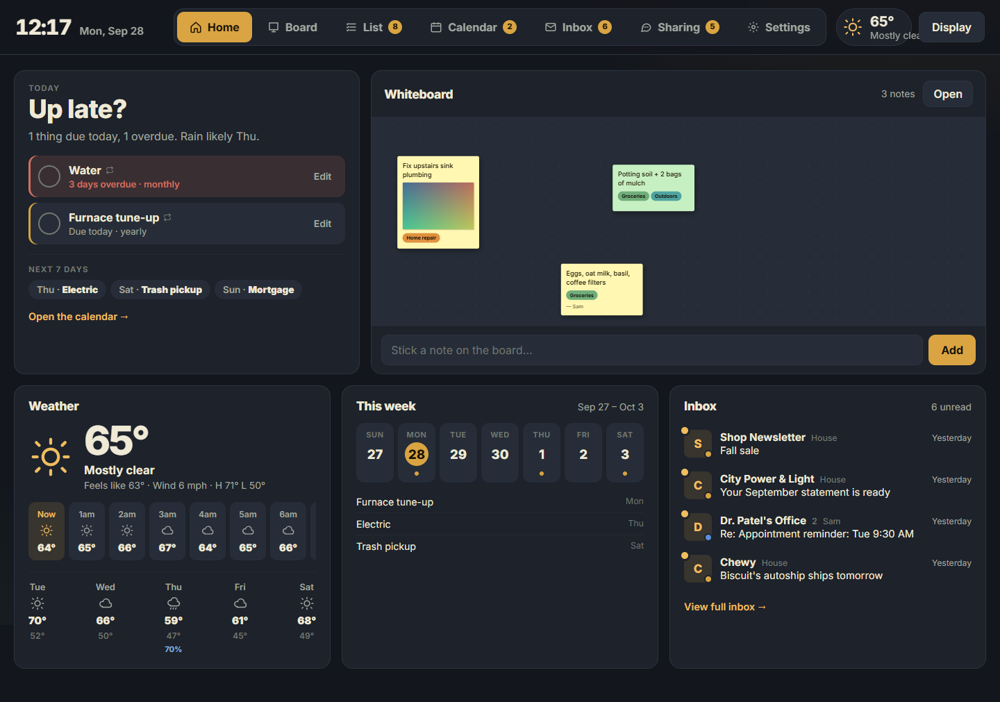
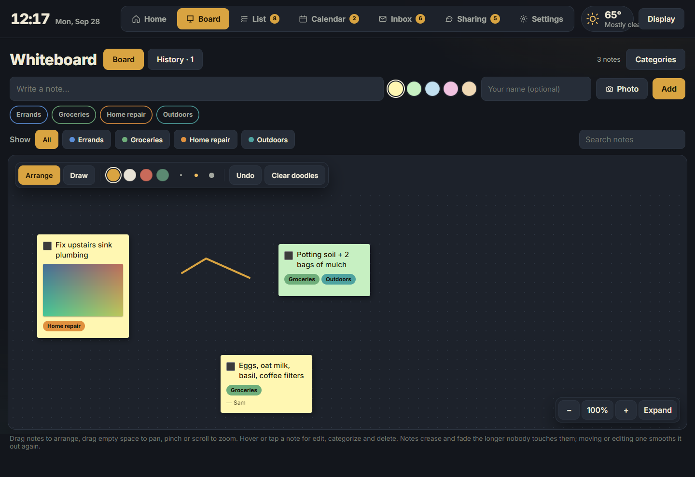
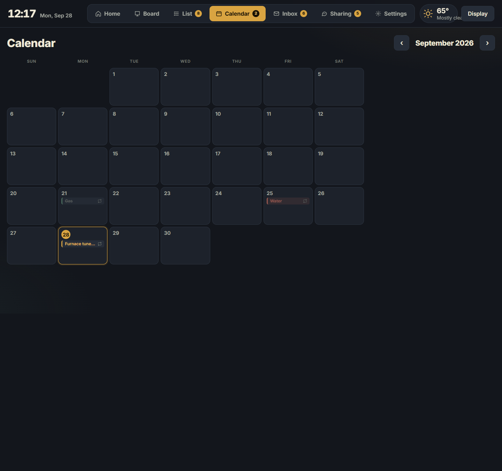
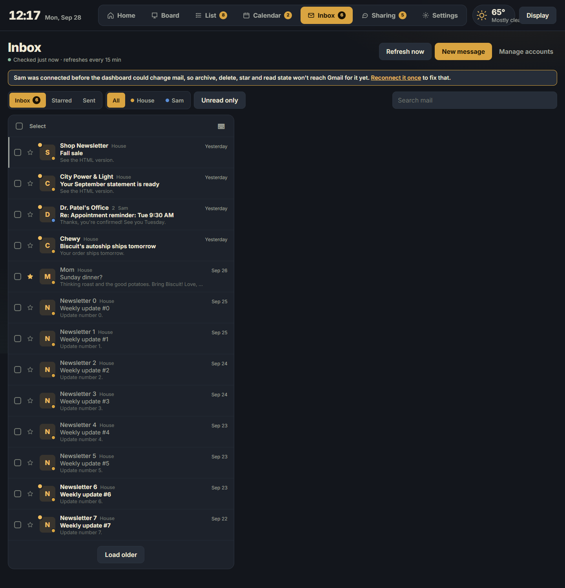
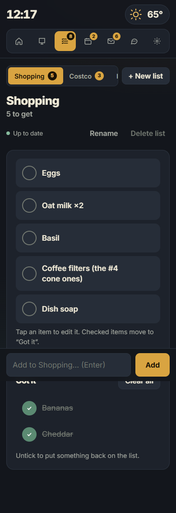
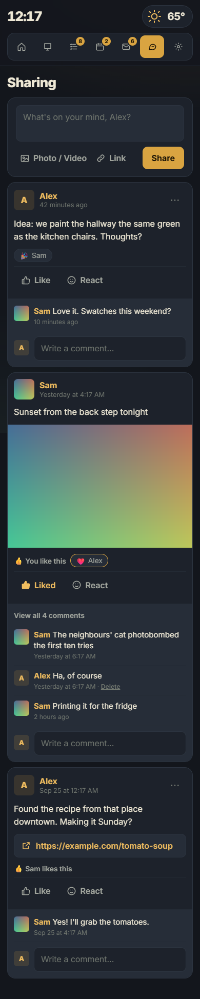

# Kitchenwall

A self-hosted family screen for the kitchen wall (and everyone's phones):
calendar, whiteboard with sticky notes and doodles, shopping lists, a shared
Gmail inbox, a little family feed, and the weather. It's what we use at home
every day. Free and open source; if it earns a spot on your wall too, a
[tip](https://ko-fi.com/cjohnsonowns) is always appreciated.



<p>
  
  
</p>
<p>
  
  
  
</p>

## What's in it
- **Home**: today, tomorrow and overdue at a glance, a peek at the whiteboard,
  weather (hourly + 5-day), a week strip and the latest mail.
- **Calendar**: one-off and recurring items (weekly … yearly), optional times,
  month view or agenda on phones. Ticking a recurring item rolls it forward.
- **Whiteboard**: drag-and-drop sticky notes with photos, your own categories,
  a freehand doodle layer, zoom and fullscreen. Notes nobody touches slowly
  crease and fade like real paper.
- **Lists**: as many shopping lists as you like, synced live between phones.
- **Inbox**: connect one or more Gmail accounts and read, reply, forward,
  archive and star together, with two-way sync to Gmail. Remote images are
  blocked until you allow them.
- **Sharing**: a small, old-school family wall for thoughts, photos, videos and
  links, with comments, likes and emoji reactions.
- **Display mode**: hides the controls for a wall tablet and refreshes on its
  own. Installable as a fullscreen app on Android.
- Dark, warm look with big touch targets. Works on phones, tablets and PCs.

**On purpose, not missing:** no money tracking, and no scorekeeping between
family members: no read receipts, "done by", streaks or per-person stats.
Nothing leaves your server except mail (Gmail) and weather (Open-Meteo).

## Install
You need a Linux box (or a Mac, or Windows with WSL) with Docker and git.

**One line:**
```sh
curl -fsSL https://raw.githubusercontent.com/CJohnsonOwns/kitchenwall/main/install.sh | bash
```
It asks for a shared household password and who lives there, then builds and
starts the container, creates a login for each person and prints the address
and their one-time passwords. Run `./install.sh` again inside the `kitchenwall`
folder to update.

**Or let your coding agent do it:**
```sh
claude "Install Kitchenwall on this machine: https://github.com/CJohnsonOwns/kitchenwall (follow its AGENTS.md)"
codex "Install Kitchenwall on this machine: https://github.com/CJohnsonOwns/kitchenwall (follow its AGENTS.md)"
```

**Or by hand:** clone the repo, `cp .env.example .env`, run
`python3 deploy/set_secrets.py` (type the household password), add `TZ=Your/Zone`
to `.env`, `mkdir data`, `docker compose up -d --build`, then add people with
`docker compose exec kitchenwall python deploy/add_user.py alex Alex`.

Add or reset a person later:
`docker compose exec kitchenwall python deploy/add_user.py sam Sam`.

## Install without Docker (Python + systemd)
```sh
sudo useradd --create-home kitchenwall
sudo -u kitchenwall -i
git clone https://github.com/CJohnsonOwns/kitchenwall.git && cd kitchenwall
python3 -m venv .venv && .venv/bin/pip install -r requirements.txt
cp .env.example .env && python3 deploy/set_secrets.py
.venv/bin/python deploy/add_user.py alex Alex
exit
sudo cp /home/kitchenwall/kitchenwall/deploy/kitchenwall*.{service,timer} /etc/systemd/system/
sudo systemctl daemon-reload && sudo systemctl enable --now kitchenwall kitchenwall-backup.timer
```
The unit is sandboxed (it can only write `data/` and `.env`), and the timer
keeps 30 nightly database backups in `~kitchenwall/household-dashboard-backups`.
Settings → Server shows service health, backups and the log.

## Logging in
The login page asks "Who's this?": one button per person plus **Household**.
- **Personal logins** (made with `deploy/add_user.py`; `--temp` makes a starter
  password they replace on first sign-in). Everyone can change their own
  password and profile picture in Settings.
- **Household** uses the shared password from `.env`. It's meant for the wall
  tablet: it can do everything except post on Sharing.

Devices stay signed in for 30 days.

## Settings
Weather location and units, week start, how far ahead Home looks, how often
mail is checked, and the Display-mode refresh interval are all in **Settings**.
Optional in `.env`: `MAX_PHOTO_MB` / `MAX_VIDEO_MB` upload caps.

## Connecting Gmail
### App password (easiest)
1. Turn on 2-Step Verification for the Gmail account.
2. Create an app password at myaccount.google.com/apppasswords.
3. In Kitchenwall: **Inbox → Manage accounts**, enter the address and that password.

Some accounts (Workspace, Advanced Protection) don't offer app passwords; use
Google sign-in instead.

### Sign in with Google (OAuth)
You need your own free Google Cloud OAuth client; nothing is shared with anyone else.
1. At console.cloud.google.com create a project and enable the **Gmail API**.
2. **OAuth consent screen**: External; add the scopes `gmail.modify`,
   `gmail.send` and `userinfo.email`; add each Gmail address you'll connect as
   a test user.
3. **Credentials → OAuth client ID → Web application**, with redirect URIs
   `http://127.0.0.1:8000/inbox/oauth/callback` and
   `http://localhost:8000/inbox/oauth/callback`.
4. Put the ID and secret in `.env` as `GOOGLE_CLIENT_ID` / `GOOGLE_CLIENT_SECRET`
   and restart.
5. Google only redirects back to localhost, so from a PC run
   `ssh -L 8000:127.0.0.1:8000 you@your-server`, open
   `http://127.0.0.1:8000/inbox/accounts` and click **Sign in with Google**.

In Google's "Testing" mode the sign-in expires after 7 days; reconnect with
step 5, or publish the consent screen (unverified is fine for your own accounts).

Mail passwords and tokens are encrypted in the database with a key the app
writes to `.env` on first run (`EMAIL_ENC_KEY`). Keep `.env` and `data/`
together in your backups, or accounts need reconnecting.

## Reaching it from outside your home
Kitchenwall is built for your home network. If you want it on your phone away
from home, put it behind a VPN (Tailscale, WireGuard) or a tunnel (e.g.
Cloudflare Tunnel) rather than opening a port. When it's served over https,
set `COOKIE_SECURE=1` and `PUBLIC_ORIGIN=https://your.address` in `.env`; it
then refuses to start with a weak household password.

## Data and backups
Everything lives in `data/` (SQLite database, photos, videos). Back up `data/`
and `.env` together.

## Contributing
Bug reports and small PRs welcome; see [CONTRIBUTING.md](CONTRIBUTING.md).

## Support
Kitchenwall is free. If your family likes it, you can
[buy me a coffee on Ko-fi](https://ko-fi.com/cjohnsonowns). Thank you!

## License
[MIT](LICENSE)
